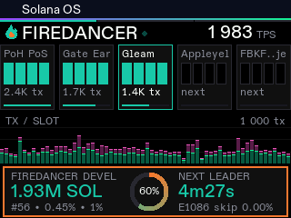
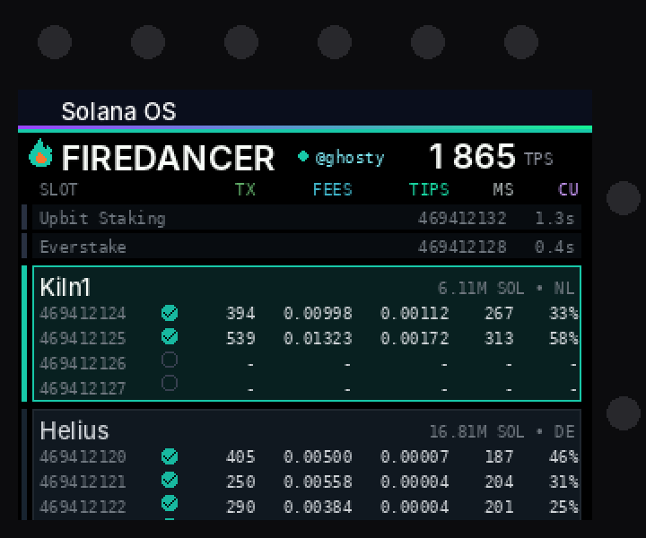
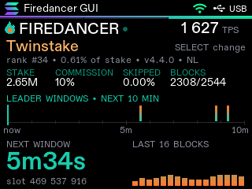
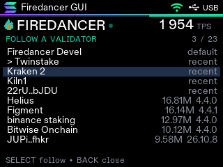

# Firedancer GUI

Un dashboard Firedancer sur le badge Solana Breakpoint : les leaders, les slots, les frais et les tips du cluster en direct, et un validateur au choix, d'après un dashboard Firedancer public (par défaut celui de Jump, `gui.firedancer.io`). Par @ghosty.

| LIVE | SCHEDULE |
|---|---|
|  |  |
| **VALIDATOR** | **Choisir le validateur** |
|  |  |

Les captures SCHEDULE, VALIDATOR et la liste viennent du badge. LIVE vient du simulateur (`tools/bench.py`, avec les polices du badge) : sur le badge, la capture d'écran passe ~20 s sur le port série, et l'app affiche « no data » pendant ce temps.

## Les vues

GAUCHE et DROITE passent d'une vue à l'autre ; la bande en haut de l'écran indique laquelle.

**LIVE**
- **Carrousel de leaders** : cinq fenêtres leader, le passé à gauche, le futur à droite, la fenêtre en cours encadrée en turquoise. Chaque carte montre le leader et ses 4 slots : le slot en cours se remplit, puis passe au bleu (completed), au turquoise foncé (notarized), au turquoise (rooted), ou au rose barré (skipped). Les cartes du validateur suivi sont orange.
- **TX / SLOT** : une barre par slot du cluster (vert : succès, rose : échecs), qui avance d'un cran à chaque slot. Les slots du validateur suivi sont en dégradé sur fond violet.
- **Panneau du validateur** : stake, rang, part du stake, commission, anneau de l'epoch, compte à rebours jusqu'à sa prochaine fenêtre (le cadre pulse en rose les 10 dernières secondes). Pendant sa fenêtre : « LEADER NOW », ses transactions et ses frais.
- **SELECT** : le mode des LED.

**SCHEDULE**, sur le modèle du leader schedule du dashboard Firedancer
- En haut, les deux prochains leaders et leur compte à rebours ; puis le leader en cours (cadre turquoise) ; puis les leaders passés.
- Chaque carte : nom, stake, pays, et ses 4 slots avec une icône d'état, les transactions, les frais, les tips (SOL), la durée (ms) et le compute utilisé.
- **HAUT / BAS** sélectionnent un slot, ligne par ligne comme à l'écran. La liste se met en pause (les nouveaux leaders attendent) et un panneau montre le slot en détail.
- **SELECT** : suivre le leader de ce slot.
- **RETOUR**, HAUT au-dessus du slot le plus récent, une autre vue, ou une minute sans toucher : retour au direct.

**VALIDATOR**
- Le validateur suivi : nom, rang, part du stake, version, pays, stake, commission, taux de skip, blocs produits sur ceux de l'epoch.
- Ses fenêtres leader des 10 prochaines minutes, le compte à rebours jusqu'à la prochaine, ses 16 derniers blocs (en transactions, rose si skippé).
- **SELECT** : la liste pour en suivre un autre.

## Choisir le validateur

Par défaut, l'app suit le validateur du dashboard (« Firedancer Devel » sur celui de Jump). Deux façons d'en suivre un autre :
- dans SCHEDULE, sélectionner un slot puis SELECT : son leader ;
- dans VALIDATOR, SELECT : une liste avec le validateur par défaut, les derniers choisis, puis les 20 plus gros par stake (avec leur version : 4.x pour Agave, 26.x pour Firedancer).

Le badge garde le choix (stockage de l'app) et le redemande au relais à chaque connexion.

## LED

- **Les 6 du haut** se remplissent slot par slot pendant la fenêtre du validateur suivi, de l'orange au turquoise (rouge pour un skip), puis flashent et s'éteignent en fondu.
- **Les 2 du côté** respirent de plus en plus vite pendant les 10 secondes avant sa fenêtre. En mode « full », elles clignotent aussi à chaque slot du cluster.
- **SELECT** (vue LIVE) : full, validateur seulement, éteintes.

## Le relais

Le badge ne peut pas lire le dashboard directement : à la connexion, celui-ci envoie deux leader schedules de ~370 Ko et des mégaoctets de gossip, puis des centaines de messages par seconde, et le badge coupe tout message de plus de 4 Ko. Un relais (Cloudflare Worker + Durable Object, `worker/` ; ou Bun, `server.ts` ; la logique commune est dans `core.ts`) suit le dashboard et envoie au badge :

- `f`, dix fois par seconde au plus : le slot estimé et le TPS ;
- `w` : une fenêtre leader complète (leader, stake, pays, et pour chaque slot l'état, les transactions, les frais, les tips, la durée, le compute), seulement quand elle change ;
- `slot` : chaque slot du validateur suivi, dès qu'il est produit ou skippé ;
- `info`, toutes les 2 s : le validateur suivi (identité, nom, stake, rang, commission, version, epoch, blocs, skips, 24 prochaines fenêtres, 16 derniers blocs).

Chaque badge suit son propre validateur : il le dit à la connexion (`/live?v=<identité>`) ou ensuite (`{"t":"follow", ...}`), et demande la liste avec `{"t":"list"}`. Le format exact est en tête de `core.ts`.

Le relais ne suit le dashboard que pendant qu'un badge est connecté, et s'arrête 30 s après le départ du dernier. Ce qu'il ne peut pas retrouver au redémarrage (les derniers blocs et les comptes de vote des validateurs suivis) est gardé dans le stockage du Durable Object. La commission et la délinquance viennent de `getVoteAccounts` (ou de Stakewiz : le RPC public refuse les adresses de Cloudflare).

Le Worker vérifie le ticket signé que le badge envoie à l'ouverture du websocket : seule l'app `firedancer-gui` peut se connecter.

## Installer

**Depuis le store** (une fois publiée) : rien d'autre à faire.

**Pour tester** : déposer `dist/firedancer-gui.zip` (`main.lua` et `app.json`) sur `/apps/submit` du site du badge, puis **Run on badge** (Chrome sur ordinateur, badge en USB-C) : un test run de 12 h. Hors store et hors test run, le serveur du badge refuse le websocket : l'app affiche « Wi-Fi denied ». Après une modification :

```sh
cd apps/firedancer-gui && zip -j dist/firedancer-gui.zip main.lua app.json
```

## Déployer

```sh
cd apps/firedancer-gui/worker && npx wrangler deploy
```

Après une modification du relais (`core.ts` ou `worker/`), changer `RELAY_NAME` dans `worker/src/index.ts` : un Durable Object déjà lancé garde son ancien code tant que des badges y sont connectés. Réglages : les `[vars]` de `worker/wrangler.toml` (`FD_WS`, `IDENTITY`, `VOTE`, `RPC_URL`, `APP`, `FRAME_MS`).

## Performances

`on_tick` tourne toutes les 30 ms. Sur le badge, l'écran coûte ~1,4 µs par pixel redessiné, sur le même processeur que l'app et le Wi-Fi. L'app ne redessine donc que ce qui change : rien de grand ne glisse (la liste et le carrousel sautent), les grands canevas sont redessinés une fois par slot ou quand leur image change, ce qui s'anime seul vit dans de petits canevas à 10 Hz au plus, et les comptes à rebours n'affichent les dixièmes que dans leurs 10 dernières secondes. L'app n'utilise pas le Bluetooth : il prendrait ~30 Ko de la RAM interne dont l'écran a besoin.

Mesuré sur le badge (firmware de diagnostic, `top`, 2026-11-15) :

| Vue | CPU | Pixels redessinés |
|---|---|---|
| LIVE | 59 % | 135 000 / s |
| SCHEDULE, en direct | 65 % | 140 000 / s |
| SCHEDULE, en pause | 30 % | 15 000 / s |
| VALIDATOR | 31 % | 33 000 / s |

## Tests

Sans badge, `tools/` fait tourner le vrai `main.lua` dans un simulateur de l'écran (Lua 5.5, les polices du badge, le coût de l'écran mesuré sur le badge), sur un enregistrement du relais ou branché sur un relais qui tourne. Il signale les textes qui passeraient à la ligne sur le badge. Le mode d'emploi est dans `CLAUDE.md` à la racine du dépôt.

Testé sur le badge (firmware officiel 2.1.0, test run) : les trois vues, la pause du leader schedule, le choix du validateur, et la charge ci-dessus.
