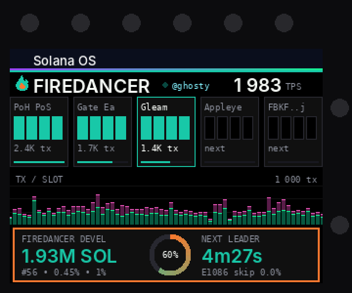

# Firedancer GUI

Un dashboard Firedancer sur le badge Solana Breakpoint : les leaders, les slots, les frais et les tips du cluster en direct, d'après un dashboard Firedancer public (par défaut celui de Jump, `gui.firedancer.io`), signé @ghosty.



L'app suit le validateur du dashboard lui-même (« Firedancer Devel » sur celui de Jump) : son stake, son rang, ses fenêtres leader, ses blocs. Pour suivre un autre validateur, ou un autre dashboard, change `IDENTITY`, `VOTE` et `FD_WS` dans `worker/wrangler.toml`.

Les captures viennent d'un simulateur de l'écran (le vrai `main.lua` dans Lua 5.5, de vraies données, des polices approchées), pas du badge. Les GIF du dossier `preview/` datent de la version précédente, aux couleurs de Galaxy. 

## Vue LIVE

LEFT et RIGHT passent d'une vue à l'autre : LIVE, SCHEDULE, VALIDATOR.

- **Carrousel de leaders** : cinq fenêtres leader, le passé à gauche et le futur à droite. La fenêtre en cours a un cadre vert.
  - Chaque carte affiche le validateur et ses 4 slots.
  - Le slot en cours se remplit pendant qu'il est produit (environ 200 ms en Alpenglow). Il passe ensuite au bleu (completed), au violet clair (notarized), puis au vert (rooted), ou au rose barré s'il est skippé.
  - Les cartes glissent quand le leader suivant prend la main. Le validateur suivi a une carte orange.
- **TX / SLOT** : une barre par slot du cluster, qui défile en continu au rythme des slots. Le vert représente les succès, le rose les échecs. Les slots de Galaxy sont en dégradé Solana sur fond violet. Le slot en cours entre par la droite.
- **Panneau du validateur** : le stake actif, le rang, la part du réseau, la commission, un anneau de progression de l'epoch et le compte à rebours jusqu'à la prochaine fenêtre. Le cadre pulse en rose pendant les 10 dernières secondes. Pendant la fenêtre, il affiche « LEADER NOW » avec les transactions et les frais au fil des slots.

## Vue SCHEDULE


Le leader schedule, sur le modèle de celui du dashboard Firedancer ([animation](preview/schedule.gif)) :

- **En haut** : les deux prochains leaders, en lignes compactes, avec leur slot et un compte à rebours.
- **Au milieu** : le leader en cours, dans une carte turquoise.
- **Dessous** : les leaders passés, du plus récent au plus ancien.
- **Chaque carte** porte le nom du leader, son stake et son pays, puis un tableau de ses 4 slots :
  - une icône de statut : cercle vide pour un slot à venir, roue qui tourne pendant la production, cercle pour completed, coche foncée pour notarized, coche turquoise pour rooted, croix rose pour skipped ;
  - les transactions, les frais (frais de base et prioritaires, en SOL), les tips, la durée (ms) et le compute utilisé (% du maximum).
- **Les en-têtes de colonnes** reprennent les couleurs du dashboard, et une barre à gauche rappelle sa colonne « Upcoming / Now / Past ».
- **Le défilement** : la liste glisse vers le bas à chaque nouveau leader.
- **La navigation** ([animation](preview/navigation.gif)) : HAUT et BAS sélectionnent un slot, un par un, dans les 8 dernières fenêtres (BAS remonte le temps). Le slot est surligné, sa carte calée en haut de la liste, et un panneau en bas l'affiche en grand : statut, transactions, frais et tips en SOL (6 décimales), durée, compute. La liste ne bouge plus tant qu'un slot est sélectionné. HAUT après le slot le plus récent, ou RETOUR, revient au direct.

Les tableaux viennent des messages `w` du relais (voir `core.ts`) : une fenêtre complète, envoyée à chaque changement, compactée sur 92 octets pour le Bluetooth.

## Vue VALIDATOR

- Une frise des fenêtres leader du validateur suivi sur les 10 prochaines minutes.
- Un grand compte à rebours.
- Le nombre de blocs produits sur ceux prévus pour l'epoch, avec le taux de skip.
- Un histogramme des 16 derniers blocs (en transactions).

## LED

- **Les 6 du haut** : elles se remplissent slot par slot pendant que le validateur suivi est leader, de l'orange au turquoise, ou en rouge pour un skip. À la fin de la fenêtre, elles font un flash puis s'éteignent en fondu.
- **Les 2 du côté** : elles respirent de plus en plus vite pendant les 10 secondes qui précèdent la fenêtre suivante. En mode « full », elles clignotent aussi à chaque slot du cluster.
- **SELECT** fait défiler les modes : full, validateur seulement, éteint.

## Le relais

Le badge ne peut pas se brancher directement sur le dashboard Firedancer de Staking Facilities (`wss://fd-mainnet.stakingfacilities.com/websocket`) :

- À la connexion, le dashboard envoie deux leader schedules d'environ 370 Ko chacun. Le badge coupe tout message de plus de 4 Ko.
- Ensuite, il envoie des centaines de messages par seconde.

Le relais suit donc ce flux et envoie au badge, toutes les 100 ms, une image complète d'environ 450 octets : les 5 fenêtres du carrousel avec l'état et les transactions de chaque slot, le slot estimé et le TPS. Comme chaque image est complète, une image perdue ne casse rien. Il envoie aussi :

- un message `slot` pour chaque slot du validateur suivi ;
- un `info` toutes les 2 s : stake, rang, epoch, blocs, skips, les 24 prochaines fenêtres et les 16 derniers blocs.

Au total, cela fait environ 3 Ko/s vers le badge. La commission, le stake exact et l'état delinquent viennent de `getVoteAccounts`, parce que le topic `peers` du dashboard laisse ces champs à 0.

## Mise en route

Le relais est déjà déployé sur Cloudflare Workers, à `https://firedancer-gui-relay.theo-b59.workers.dev`. `main.lua` et `app.json` pointent dessus.

**Installer l'app** : va sur `/apps/submit` du site du badge et dépose `dist/firedancer-gui.zip` (il ne contient que `main.lua` et `app.json`). Clique ensuite sur **Run on badge** (Chrome ou Edge sur ordinateur, badge en USB-C) : ça ouvre un test run de 12 h. Pour la garder, publie-la.

Si tu modifies `main.lua` ou `app.json`, refais le zip :

```sh
cd apps/firedancer-gui && zip -j dist/firedancer-gui.zip main.lua app.json
```

### Depuis un téléphone, sans le site

`https://firedancer-gui-relay.theo-b59.workers.dev/install#k=<clé>`, à ouvrir dans Chrome sur Android, fait les deux étapes :

1. **Installer en USB.** La page parle à la console série du badge (puce CH340, WebUSB) et copie `app.json` et `main.lua` avec `lua put`, puis lance l'app.
2. **Données en Bluetooth.** Une app copiée ainsi n'est ni publiée ni en test run : le serveur du badge lui refuse le Wi-Fi (« denied »). La page suit donc le relais à sa place et écrit les mêmes messages au badge en Bluetooth, compactés (154 octets au plus). Elle doit rester ouverte, téléphone à portée.

La clé `k` est le secret `PHONE_KEY` du Worker (`npx wrangler secret put PHONE_KEY`). Sans elle, `/phone` répond 403.

Si l'app est publiée dans le store, le badge passe par le Wi-Fi tout seul et le téléphone n'est plus nécessaire.

### L'app Android (`android/`)

L'app Android fait tout sans la page web : l'installation sur le badge en USB (la puce CH340 par l'API hôte USB d'Android, le même dialogue `lua put` que la page) et le relais Bluetooth, dans un service de premier plan (notification « Firedancer GUI ») qu'Android laisse tourner en arrière-plan. Brancher le badge propose aussi d'ouvrir l'app.

- Téléchargement : le bouton « Télécharger l'app Android » de la page, ou `/app/firedancer-gui.apk?k=<clé>` (403 sans la clé, qui est dans l'APK).
- Dans l'app : « Démarrer le relais », accepter les permissions Bluetooth et notifications, puis « Ne pas couper en arrière-plan (batterie) ».
- L'écran affiche l'état du relais, celui du badge et les deux débits.

Compilation sans Gradle (JDK, Android SDK avec `build-tools;35.0.0` et `platforms;android-34`), puis mise en ligne :

```sh
cd apps/firedancer-gui/android
ANDROID_HOME=~/android-sdk PHONE_KEY=<clé> VERSION=2 ./build.sh
cd ../worker && npx wrangler kv key put --binding FILES firedancer-gui.apk --path ../android/build/firedancer-gui.apk --remote
```

Garde le fichier de signature (`KEYSTORE`, créé au premier build) : Android n'installe une mise à jour que si elle est signée par la même clé. Augmente `VERSION` à chaque nouvelle version.

### Le relais sur Cloudflare (`worker/`)

- Un Durable Object tient le websocket vers le dashboard Firedancer et ceux des badges.
- Il ne suit le flux que lorsqu'un badge est connecté, et s'arrête 30 s après le départ du dernier. Le premier badge attend une ou deux secondes le leader schedule.
- `GET /status` renvoie l'état courant en JSON.
- Le Worker vérifie le ticket signé que le badge envoie à l'ouverture du websocket : seule l'app `firedancer-gui` peut se connecter (403 sinon).
- Les réglages sont les `[vars]` de `worker/wrangler.toml` : `FD_WS`, `IDENTITY`, `VOTE`, `RPC_URL`, `APP`, `FRAME_MS`.

Après une modification du relais (`core.ts` ou `worker/`), change aussi `RELAY_NAME` dans `worker/src/index.ts` : une instance déjà lancée garde son ancien code tant que des clients y sont connectés, même après un déploiement.

Pour redéployer après une modification :

```sh
cd apps/firedancer-gui/worker && npx wrangler deploy
```

### Le relais ailleurs (`server.ts`)

Le même relais tourne avec Bun, derrière HTTPS sur le port 443 :

```sh
PUBLIC_URL=https://relay.ton-domaine.xyz PORT=8080 bun server.ts
```

Il prend les mêmes réglages en variables d'environnement. `DEV_NO_TICKET=1` désactive la vérification du ticket, pour les tests en local uniquement.

## Performances

L'app vise le maximum que permet le badge : `on_tick` tourne toutes les 30 ms (environ 33 images par seconde, fixé par le firmware). L'écran coûte environ 0,45 µs par pixel plus environ 1 ms par zone redessinée ; toute la zone de l'app prend environ 35 ms (CHANGELOG 2.1.0). Une image n'est donc tenue que si ce qu'elle redessine coûte moins de 30 ms. Ce qui en découle :

- **Rien n'est redessiné sans avoir changé.** Les étiquettes, couleurs et positions sont mises en cache, et les LED ne sont écrites que quand leur couleur change.
- **Ce qui bouge tout seul a son propre petit canevas** :
  - les cases de slots du carrousel (52×24) ;
  - les icônes d'état de chaque carte du leader schedule (9×48).

  La roue qui tourne ou la case qui se remplit redessine quelques centaines de pixels, pas la carte ni la liste.
- **Le fond de la liste** du leader schedule n'est redessiné que quand la liste bouge ou change de forme, pas à chaque message.
- **Le cadre du panneau du validateur** est fait de 4 fines bandes : quand il clignote, seules les bandes sont redessinées.
- **Les glissements** (carrousel, liste) convergent en 4 à 5 images : une liste qui bouge se redessine en entier, donc le moins d'images possible.
- **Aucune table ni chaîne n'est construite dans un tick** si aucun message ne l'a rendue périmée : moins de travail pour le ramasse-miettes.
- **Le protocole** : les images à 10 Hz ne portent que le slot et le TPS (9 octets en Bluetooth au lieu de 184). Les détails de chaque fenêtre (`w`, 92 octets) ne partent que quand ils changent.

Mesures avec un simulateur de l'écran, sur les mêmes 45 s de vraies données, avec le modèle de coût ci-dessus :

| Vue | Écran par tick, avant → après | Ticks > 25 ms | Instructions Lua par tick |
|---|---|---|---|
| LIVE | 12,3 → 10,1 ms | 1 % → 1 % | 7 200 → 5 600 |
| SCHEDULE (direct) | 18,5 → 7,2 ms | 65 % → 17 % | 8 600 → 3 500 |
| SCHEDULE (navigation) | 16,8 → 4,8 ms | 58 % → 14 % | 7 100 → 2 900 |
| VALIDATOR | 3,8 → 3,2 ms | 0 % | 5 800 → 1 200 |

Autres gains mesurés :

- **Mémoire Lua allouée** : 635 → 95 Ko/s.
- **Pire callback** : 30 700 → 10 700 instructions (le maximum autorisé est 200 000).
- **Écritures LED** : 8 → moins de 2 par tick.
- **Trafic Bluetooth** : 2,4 → 0,9 Ko/s.

Les ticks au-dessus de 25 ms qui restent sont les images de glissement, où toute la liste bouge.

## Testé

- **Le relais sur Cloudflare** : l'app, dans la prévisualisation, s'y est connectée et a reçu le flux en direct. Sans ticket de badge, il refuse la connexion (403).
- **Le leader schedule** : le relais trouve 6 920 slots pour Galaxy sur l'epoch, comme `getLeaderSchedule`.
- **L'app** a tourné dans la prévisualisation pendant de vraies fenêtres de Galaxy (par exemple les slots 469 352 188 à 469 352 191). Toutes les captures viennent de là.
  - Au pire, une callback a coûté 32 000 instructions, pour une limite de 200 000 sur le badge.
  - Aucun message n'a dépassé 4 Ko.
- **Le chemin Bluetooth** : 30 s de vrais messages du relais, compactés par le code de la page puis décodés par l'app, donnent le même écran que le chemin Wi-Fi.
- **L'app Android**, testée hors téléphone : son installateur contre une console de badge simulée (lignes parasites, fin de ligne perdue), son client WebSocket reçoit le relais (local et Cloudflare en HTTPS), et son compactage donne les mêmes octets que la page sur 215 messages réels et des cas limites. Pas encore testée sur un téléphone (Bluetooth, service en arrière-plan).
- **Pas testé du tout** : la page d'installation sur du vrai matériel (WebUSB vers le CH340, console série, Web Bluetooth).
- **Pas encore testé** sur un vrai badge : ni le ticket signé par le serveur du badge, ni la fluidité sur l'écran SPI. Le carrousel est redessiné à chaque tick (30 ms) et l'histogramme un tick sur deux. Si ça rame, augmente ces intervalles dans `on_tick`.
- Depuis Cloudflare, le RPC public Solana ne répond pas. La commission et le stake viennent alors de Stakewiz.
