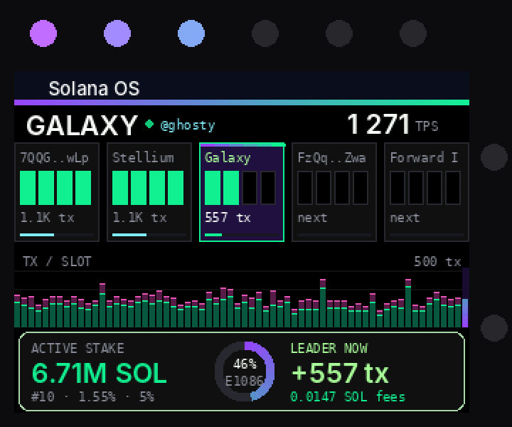
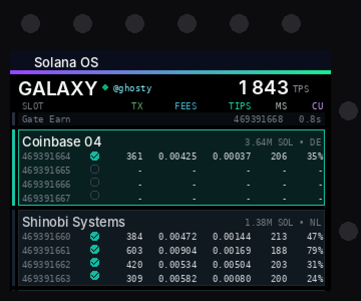

# Galaxy Live

Le cluster Solana qui produit ses blocs, en direct sur le badge, avec le validateur Galaxy au premier plan. C'est une version au format du badge du dashboard Firedancer, signée @ghosty.



Ces images viennent d'une prévisualisation, pas du badge lui-même. Le vrai `main.lua` tourne dans Lua 5.5, et les objets `ui` sont redessinés avec les couleurs du thème du badge. Les données viennent du flux réel. Les polices sont des approximations. Animation : [preview/galaxy_live_2x.gif](preview/galaxy_live_2x.gif).

## Vue LIVE

LEFT et RIGHT passent d'une vue à l'autre : LIVE, SCHEDULE, GALAXY.

- **Carrousel de leaders** : cinq fenêtres leader, le passé à gauche et le futur à droite. La fenêtre en cours a un cadre vert.
  - Chaque carte affiche le validateur et ses 4 slots.
  - Le slot en cours se remplit pendant qu'il est produit (environ 200 ms en Alpenglow). Il passe ensuite au bleu (completed), au violet clair (notarized), puis au vert (rooted), ou au rose barré s'il est skippé.
  - Les cartes glissent quand le leader suivant prend la main. Galaxy a une carte violette avec un liseré en dégradé Solana.
- **TX / SLOT** : une barre par slot du cluster, qui défile en continu au rythme des slots. Le vert représente les succès, le rose les échecs. Les slots de Galaxy sont en dégradé Solana sur fond violet. Le slot en cours entre par la droite.
- **Panneau Galaxy** : le stake actif, le rang, la part du réseau, la commission, un anneau de progression de l'epoch et le compte à rebours jusqu'à la prochaine fenêtre. Le cadre pulse en rose pendant les 10 dernières secondes. Pendant la fenêtre, il affiche « LEADER NOW » avec les transactions et les frais au fil des slots.

## Vue SCHEDULE



Le leader schedule en tableau, comme sur le dashboard : les deux prochains leaders, le leader en cours, puis les six derniers. Chaque ligne donne les 4 slots, les transactions, les frais collectés (en SOL : frais, frais prioritaires et tips) et la durée moyenne d'un slot (en ms).

## Vue GALAXY

- Une frise des fenêtres leader de Galaxy sur les 10 prochaines minutes.
- Un grand compte à rebours.
- Le nombre de blocs produits sur ceux prévus pour l'epoch, avec le taux de skip.
- Un histogramme des 16 derniers blocs (en transactions).

## LED

- **Les 6 du haut** : elles se remplissent slot par slot pendant que Galaxy est leader, du violet au vert, ou en rouge pour un skip. À la fin de la fenêtre, elles font un flash puis s'éteignent en fondu.
- **Les 2 du côté** : elles respirent de plus en plus vite pendant les 10 secondes qui précèdent la fenêtre suivante. En mode « full », elles clignotent aussi à chaque slot du cluster.
- **SELECT** fait défiler les modes : full, Galaxy seulement, éteint.

## Le relais

Le badge ne peut pas se brancher directement sur le dashboard Firedancer de Staking Facilities (`wss://fd-mainnet.stakingfacilities.com/websocket`) :

- À la connexion, le dashboard envoie deux leader schedules d'environ 370 Ko chacun. Le badge coupe tout message de plus de 4 Ko.
- Ensuite, il envoie des centaines de messages par seconde.

Le relais suit donc ce flux et envoie au badge, toutes les 100 ms, une image complète d'environ 450 octets : les 5 fenêtres du carrousel avec l'état et les transactions de chaque slot, le slot estimé et le TPS. Comme chaque image est complète, une image perdue ne casse rien. Il envoie aussi :

- un message `slot` pour chaque slot de Galaxy ;
- un `info` toutes les 2 s : stake, rang, epoch, blocs, skips, les 24 prochaines fenêtres et les 16 derniers blocs.

Au total, cela fait environ 3 Ko/s vers le badge. La commission, le stake exact et l'état delinquent viennent de `getVoteAccounts`, parce que le topic `peers` du dashboard laisse ces champs à 0.

## Mise en route

Le relais est déjà déployé sur Cloudflare Workers, à `https://galaxy-live-relay.theo-b59.workers.dev`. `main.lua` et `app.json` pointent dessus.

**Installer l'app** : va sur `/apps/submit` du site du badge et dépose `dist/galaxy-live.zip` (il ne contient que `main.lua` et `app.json`). Clique ensuite sur **Run on badge** (Chrome ou Edge sur ordinateur, badge en USB-C) : ça ouvre un test run de 12 h. Pour la garder, publie-la.

Si tu modifies `main.lua` ou `app.json`, refais le zip :

```sh
cd apps/galaxy && zip -j dist/galaxy-live.zip main.lua app.json
```

### Depuis un téléphone, sans le site

`https://galaxy-live-relay.theo-b59.workers.dev/install#k=<clé>`, à ouvrir dans Chrome sur Android, fait les deux étapes :

1. **Installer en USB.** La page parle à la console série du badge (puce CH340, WebUSB) et copie `app.json` et `main.lua` avec `lua put`, puis lance l'app.
2. **Données en Bluetooth.** Une app copiée ainsi n'est ni publiée ni en test run : le serveur du badge lui refuse le Wi-Fi (« denied »). La page suit donc le relais à sa place et écrit les mêmes messages au badge en Bluetooth, compactés (154 octets au plus). Elle doit rester ouverte, téléphone à portée.

La clé `k` est le secret `PHONE_KEY` du Worker (`npx wrangler secret put PHONE_KEY`). Sans elle, `/phone` répond 403.

Si l'app est publiée dans le store, le badge passe par le Wi-Fi tout seul et le téléphone n'est plus nécessaire.

### L'app Android (`android/`)

L'app Android fait tout sans la page web : l'installation sur le badge en USB (la puce CH340 par l'API hôte USB d'Android, le même dialogue `lua put` que la page) et le relais Bluetooth, dans un service de premier plan (notification « Galaxy Live ») qu'Android laisse tourner en arrière-plan. Brancher le badge propose aussi d'ouvrir l'app.

- Téléchargement : le bouton « Télécharger l'app Android » de la page, ou `/app/galaxy-live.apk?k=<clé>` (403 sans la clé, qui est dans l'APK).
- Dans l'app : « Démarrer le relais », accepter les permissions Bluetooth et notifications, puis « Ne pas couper en arrière-plan (batterie) ».
- L'écran affiche l'état du relais, celui du badge et les deux débits.

Compilation sans Gradle (JDK, Android SDK avec `build-tools;35.0.0` et `platforms;android-34`), puis mise en ligne :

```sh
cd apps/galaxy/android
ANDROID_HOME=~/android-sdk PHONE_KEY=<clé> VERSION=2 ./build.sh
cd ../worker && npx wrangler kv key put --binding FILES galaxy-live.apk --path ../android/build/galaxy-live.apk --remote
```

Garde le fichier de signature (`KEYSTORE`, créé au premier build) : Android n'installe une mise à jour que si elle est signée par la même clé. Augmente `VERSION` à chaque nouvelle version.

### Le relais sur Cloudflare (`worker/`)

- Un Durable Object tient le websocket vers le dashboard Firedancer et ceux des badges.
- Il ne suit le flux que lorsqu'un badge est connecté, et s'arrête 30 s après le départ du dernier. Le premier badge attend une ou deux secondes le leader schedule.
- `GET /status` renvoie l'état courant en JSON.
- Le Worker vérifie le ticket signé que le badge envoie à l'ouverture du websocket : seule l'app `galaxy-live` peut se connecter (403 sinon).
- Les réglages sont les `[vars]` de `worker/wrangler.toml` : `FD_WS`, `IDENTITY`, `VOTE`, `RPC_URL`, `APP`, `FRAME_MS`.

Pour redéployer après une modification :

```sh
cd apps/galaxy/worker && npx wrangler deploy
```

### Le relais ailleurs (`server.ts`)

Le même relais tourne avec Bun, derrière HTTPS sur le port 443 :

```sh
PUBLIC_URL=https://galaxy.ton-domaine.xyz PORT=8080 bun server.ts
```

Il prend les mêmes réglages en variables d'environnement. `DEV_NO_TICKET=1` désactive la vérification du ticket, pour les tests en local uniquement.

## Testé

- **Le relais sur Cloudflare** : l'app, dans la prévisualisation, s'y est connectée et a reçu le flux en direct. Sans ticket de badge, il refuse la connexion (403).
- **Le leader schedule** : le relais trouve 6 920 slots pour Galaxy sur l'epoch, comme `getLeaderSchedule`.
- **L'app** a tourné dans la prévisualisation pendant de vraies fenêtres de Galaxy (par exemple les slots 469 352 188 à 469 352 191). Toutes les captures viennent de là.
  - Au pire, une callback a coûté 32 000 instructions, pour une limite de 200 000 sur le badge.
  - Aucun message n'a dépassé 4 Ko.
- **Le chemin Bluetooth** : 30 s de vrais messages du relais, compactés par le code de la page puis décodés par l'app, donnent le même écran que le chemin Wi-Fi.
- **L'app Android**, testée hors téléphone : son installateur contre une console de badge simulée (lignes parasites, fin de ligne perdue), son client WebSocket reçoit le relais (local et Cloudflare en HTTPS), et son compactage donne les mêmes octets que la page sur 215 messages réels et des cas limites. Pas encore testée sur un téléphone (Bluetooth, service en arrière-plan).
- **Pas testé du tout** : la page d'installation sur du vrai matériel (WebUSB vers le CH340, console série, Web Bluetooth).
- **Pas encore testé** sur un vrai badge : ni le ticket signé par le serveur du badge, ni la fluidité sur l'écran SPI. Le carrousel est redessiné à chaque tick (30 ms) et l'histogramme un tick sur deux. Si ça rame, augmente ces intervalles dans `on_tick`.
- Depuis Cloudflare, le RPC public Solana ne répond pas. La commission et le stake viennent alors de Stakewiz.
